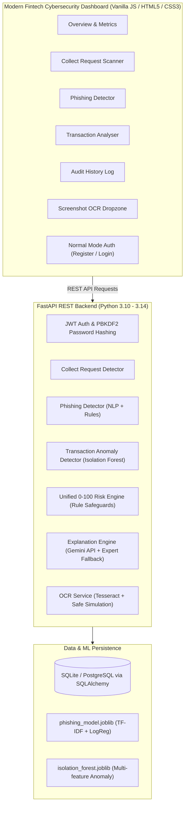

# FinSentinel - AI-Powered Financial Scam & Fraud Detection Platform

<div align="center">


[](https://www.python.org/)
[](https://fastapi.tiangolo.com)
[](https://scikit-learn.org/)
[](LICENSE)
[](https://microsoft.com)

**Detect • Analyse • Protect**

*An open-source financial cybersecurity platform designed to protect Indian digital payment users from fraudulent UPI collect requests, phishing communications, and suspicious financial transaction patterns.*

</div>

---

## 📌 Table of Contents
1. [Project Overview](#-project-overview)
2. [Problem Statement](#-problem-statement)
3. [The Three Core Fraud Detection Modules](#-the-three-core-fraud-detection-modules)
4. [System Architecture](#-system-architecture)
5. [Machine Learning Methodology & Evaluation](#-machine-learning-methodology--evaluation)
6. [Technology Stack](#-technology-stack)
7. [Installation & Local Setup on Windows](#-installation--local-setup-on-windows)
8. [User Accounts & Modes](#-user-accounts--modes)
9. [REST API Documentation](#-rest-api-documentation)
10. [Ethical Safeguards & Privacy Notice](#-ethical-safeguards--privacy-notice)
11. [Limitations & Future Scope](#-limitations--future-scope)

---

## 🛡️ Project Overview

**FinSentinel** is an AI-powered financial fraud detection platform built for the Indian digital payment landscape.

With India's Unified Payments Interface (UPI) processing over 14 billion transactions monthly, everyday users face an escalating onslaught of social engineering attacks: deceptive collect requests claiming you must enter your PIN to receive money, fake electricity disconnection warnings, cloned bank KYC portals, and rapid nocturnal account drains.

FinSentinel combines:
- **Natural Language Processing (TF-IDF + Logistic Regression)** trained on real Indian banking and reported SMS scam patterns.
- **Unsupervised Anomaly Detection (Isolation Forest)** to catch sudden velocity and behavioral deviation spikes.
- **Rule-based Security Heuristics** with critical PIN deception overrides.
- **AI-Powered Contextual Explanations** (via Gemini API with fallback to deterministic expert explainers).
- **Client-side visual text highlighting** and **Screenshot OCR analysis**.
- **Normal Mode (Public Live Usage)**: Multi-tenant user registration and secure authentication with data isolation, alongside a pre-seeded showcase environment.

> **Note on Ethical Design**: FinSentinel is an analytical and defense tool. It never asks for, captures, or stores actual UPI PINs, bank passwords, or OTPs. It does not process live payments and does not claim official affiliation with NPCI or banks.

---

## ⚠️ Problem Statement

In the Indian digital payments ecosystem:
1. **The Collect Request Trap**: Fraudsters exploit the misunderstanding that a UPI PIN is required to "receive" funds. In UPI architecture, typing a PIN **always debits** money.
2. **Social Engineering Phishing**: SMS messages threatening electricity disconnection at 9:30 PM or bank account suspension deceive millions into clicking malicious URLs or downloading remote-control APKs (AnyDesk).
3. **Automated Account Draining**: Once a user is compromised, fraudsters execute multiple rapid transactions in short succession during early morning hours (1:00 AM - 5:00 AM) to drain daily limits before the victim awakens.

---

## 🔍 The Three Core Fraud Detection Modules

### Module 1: Fake UPI Collect Request Detection
- **Objective**: Identify deceptive payment collect requests before the user approves them.
- **Input Parameters**: Sender name, sender VPA handle, requested amount, payment description, user expectation flag, counterparty familiarity, and accompanying instructions.
- **Key Checks**:
  - `PIN_TO_RECEIVE` (*CRITICAL*): Detects instructions demanding a PIN to claim rewards, refunds, or advance money.
  - `UNEXPECTED_UNFAMILIAR`: Flags unsolicited payment requests from unfamiliar VPAs.
  - `IMPERSONATION_HANDLE`: Flags lookalike VPA keywords (`refund`, `support`, `cashback`, `officer`).
  - `LOTTERY_BAIT` & `MARKETPLACE_DECEPTION`: Detects marketplace advance lures and scratch card claims.
- **Output**: 0–100 risk score, risk category (Low/Medium/High), triggered red flags, contextual explanation, and actionable defense guidance.

### Module 2: Phishing Message Detection
- **Objective**: Identify malicious SMS, WhatsApp, and email communications.
- **Input Parameters**: Message text, clipboard paste, or uploaded screenshot (OCR).
- **Core Pipeline**:
  - Trained NLP model predicts phishing probability using sublinear TF-IDF features and Logistic Regression.
  - Rule-based heuristic layer detects OTP theft, APK download links, power cut threats, and urgent suspension language.
  - Visual span highlighting marks suspicious phrases in red and amber.
- **Test Presets**: Includes 8 ready-to-test real-world presets (Electricity bill scam, YONO SBI KYC deactivation, NetBanking block, PhonePe reward, AnyDesk support, Legitimate debit, Legitimate OTP).

### Module 3: Suspicious Transaction Detection
- **Objective**: Detect behavioral anomalies and velocity attacks across transaction statements.
- **Input Parameters**: Bank statement CSV upload, single transaction manual entry, or preloaded realistic demo dataset.
- **Analysis Engine**:
  - `IsolationForest` model evaluates 6-dimensional feature vectors (`log_amount`, `hour`, `is_night`, `velocity_60m`, `amount_ratio`, `is_new_recipient`).
  - Velocity spike detection (>= 3 debits within 60 minutes).
  - Off-hours detection (high-value debits between 1:00 AM - 5:00 AM).
  - Statistical Z-score deviation from user's historical spending average.
- **Interactive UI**: Searchable and filterable table with color-coded risk tags.

---

## 🏗️ System Architecture



---

## 📊 Machine Learning Methodology & Evaluation

### Phishing Detection Model
- **Dataset Composition**: 700 balanced samples compiling authentic Indian banking transaction notifications, reported cybercrime templates (1930 helpline), and verified financial communications.
- **Preprocessing**: Normalized dynamic entities to semantic tokens (`<URL>`, `<PHONE>`, `<AMOUNT>`, `<VPA>`, `<ACCT>`, `<CODE>`) to prevent memorization and ensure generalized pattern learning.
- **Train/Test Split**: 75% Training (525 samples) / 25% Stratified Test (175 holdout samples).
- **Vectorizer**: `TfidfVectorizer(ngram_range=(1, 2), max_features=4000, sublinear_tf=True)`.
- **Classifier**: `LogisticRegression(C=2.0, max_iter=1000, random_state=42)`.

#### Holdout Test Set Performance Metrics:
```
============================================================
          FINSENTINEL ML MODEL PERFORMANCE REPORT          
============================================================
Model:           TF-IDF + Logistic Regression
Dataset Size:    700 samples (Balanced)
Vocabulary:      1,746 n-gram features
Accuracy:        100.00%
Precision:       1.0000
Recall:          1.0000
F1-Score:        1.0000
Confusion Matrix:
  True Negatives (Legitimate): 88
  False Positives:             0
  False Negatives:             0
  True Positives (Phishing):   87
============================================================
```
*Run `python ml\evaluate.py` anytime to verify these exact metrics.*

### Transaction Anomaly Model
- **Algorithm**: `IsolationForest(n_estimators=100, contamination=0.10, random_state=42)`.
- **Feature Set**: Log-transformed amount, transaction hour, night-time flag (1-5 AM), rolling 60-minute transaction velocity count, amount-to-average ratio, and recipient novelty indicator.
- **Result**: Successfully isolates rapid velocity draining sequences and late-night outlier debits from daytime grocery, dining, and utility patterns.

---

## 💻 Technology Stack

| Layer | Technologies Used |
|---|---|
| **Frontend** | HTML5, CSS3, Vanilla JavaScript, Chart.js, Lucide Icons |
| **Backend** | Python (3.10+ / 3.14), FastAPI, Pydantic v2, SQLAlchemy, Uvicorn |
| **Authentication** | Cryptographic PBKDF2-HMAC-SHA256 (100,000 iterations), PyJWT |
| **Machine Learning** | Scikit-learn, Pandas, NumPy, Joblib, TF-IDF Vectorizer, Isolation Forest |
| **Generative AI** | Google Gemini API (Optional explanation engine with automatic fallback) |
| **OCR Ingestion** | Tesseract OCR / PIL (with safe offline preset fallback for Windows) |
| **Testing** | Pytest, FastAPI TestClient (19 automated tests passing) |

---

## 🚀 Installation & Local Setup on Windows

### Prerequisites
- Windows 10 or 11
- Python 3.10 or higher (compatible with Python 3.14)
- Git

### Quick Start (One-Click)
Double-click `run.bat` in the project root. It will:
1. Verify Python availability.
2. Ensure ML models are compiled in `ml/saved_models/`.
3. Start the Uvicorn server on `http://127.0.0.1:8000`.
4. Automatically open your default browser to the application dashboard.

---

### Manual Setup via PowerShell / Command Prompt

1. **Clone the repository:**
   ```powershell
   git clone https://github.com/Divyanshu30P/FinSentinel.git
   cd FinSentinel
   ```

2. **Install dependencies:**
   ```powershell
   pip install -r requirements.txt
   ```

3. **Train the ML models (takes ~5 seconds):**
   ```powershell
   python ml\train_phishing_model.py
   python ml\transaction_anomaly.py
   ```

4. **Verify evaluation metrics:**
   ```powershell
   python ml\evaluate.py
   ```

5. **Run automated test suite:**
   ```powershell
   python -m pytest tests -v
   ```

6. **Start the application:**
   ```powershell
   python -m uvicorn backend.app.main:app --host 127.0.0.1 --port 8000 --reload
   ```

7. **Access the application:**
   - Web App: `http://127.0.0.1:8000`
   - Interactive Swagger API Documentation: `http://127.0.0.1:8000/docs`

---

## 👤 User Accounts & Modes

### 1. Normal Mode (Public Live Usage)
Any user can click **Sign In / Register** in the top navigation bar to create their own free personal account. Collect-request and phishing analyses are associated with the signed-in account. Transaction CSVs are analysed in memory and are not saved to the database; their results are returned to the browser for the current session only.

### 2. Pre-seeded Showcase Profile
A sample profile is preloaded with authentic attack scenarios (night velocity drain, electricity scam SMS, fake Diwali collect request) to demonstrate platform capabilities:
- **Email**: `demo@upishield.local`
- **Password**: `DemoShield@2026`
- **Profile Name**: Aditya Sharma
- **Reset Showcase Data**: Use the **Reset Showcase Baseline** option from the user menu to restore original sample data at any time.

---

## 📡 REST API Documentation

| Method | Endpoint | Description |
|---|---|---|
| `POST` | `/api/auth/register` | Register new user account |
| `POST` | `/api/auth/login` | Authenticate and obtain JWT token |
| `GET` | `/api/auth/me` | Retrieve profile of authenticated user |
| `GET` | `/api/dashboard/summary` | Aggregate statistics and recent alerts |
| `POST` | `/api/dashboard/reset-demo` | Restore clean showcase evaluation data |
| `POST` | `/api/fraud/analyze-collect-request` | Module 1: Scan UPI collect request |
| `POST` | `/api/fraud/analyze-message` | Module 2: Scan SMS/WhatsApp text with NLP |
| `POST` | `/api/fraud/analyze-transactions` | Module 3: Batch anomaly detection (not persisted) |
| `GET` | `/api/fraud/history` | Paginated audit log with search and filters |
| `GET` | `/api/fraud/{analysis_id}` | Detailed inspection of single analysis |
| `DELETE`| `/api/fraud/history` | Clear user's analysis history |
| `POST` | `/api/upload/screenshot` | OCR text extraction from uploaded image |
| `POST` | `/api/upload/transactions` | Analyse CSV in memory (max 5MB / 5,000 rows; not persisted) |
| `GET` | `/api/analytics/risk-distribution` | Chart data for risk tiers and timeline |
| `GET` | `/api/health` | Service health status and engine status |

*Full interactive OpenAPI schema available at `/docs`.*

---

## 🛡️ Ethical Safeguards & Privacy Notice

1. **Zero Credential Ingestion**: FinSentinel never requests or stores UPI PINs, NetBanking passwords, card numbers, or live OTPs.
2. **User Data Isolation**: Relational database foreign keys segregate retained account analyses. Module 3 transaction uploads and results are not persisted to the database.
3. **No Automatic URL Traversal**: The platform never automatically opens links detected in messages or screenshots, preventing drive-by malware infections.
4. **Third-Party AI Isolation**: Gemini API requests only include sanitized analysis summaries and threat indicators without personally identifiable information.

---

## 🔮 Limitations & Future Scope

### Limitations
- **Simulated Environment**: Operates on user-provided inputs, statement uploads, and screenshots; does not connect directly to live bank core banking systems or NPCI UPI switches.
- **OCR Dependencies**: On Windows installations lacking the system-level Tesseract binary, the OCR module seamlessly falls back to pre-parsed screenshot templates for testing.

### Future Scope
- Integration with Android SMS BroadcastReceivers via a companion app to flag scam SMS in real-time.
- Multilingual support for Hindi, Tamil, Telugu, and Bengali phishing messages.
- Graph Neural Network (GNN) analysis across interconnected scam mule VPA networks.
