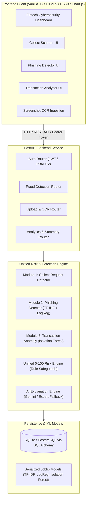

# FinSentinel - System Architecture Specification

## Overview

FinSentinel is a cybersecurity fintech application built specifically to protect digital payment users from deceptive UPI collect requests, phishing communications, and suspicious financial transaction patterns.

---

## 1. High-Level Architectural Flow

---

## 2. Core Detection Modules

### Module 1: Fake UPI Collect Request Detection
- **Deception Mechanism**: Scammers initiate payment collect requests claiming "Enter PIN to receive prize / refund / advance money".
- **Analysis Vector**:
  1. User expectation flag & counterparty familiarity.
  2. Description & instruction NLP heuristics (PIN solicitation, prize bait, lottery).
  3. VPA keyword spoofing (`refund`, `support`, `cashback`, `officer`).
  4. Amount anomaly heuristics.
- **Rule Safeguard**: Asking for UPI PIN to receive money immediately triggers a `CRITICAL` severity override, elevating the risk score to High Risk (>= 78/100).

### Module 2: Financial Phishing & SMS Scam Detection
- **Deception Mechanism**: Urgent electricity disconnection threats, fake bank KYC deactivation alerts, lottery prizes, and remote-access APKs.
- **NLP ML Pipeline**:
  - Preprocessing: Semantic entity normalization (`<URL>`, `<PHONE>`, `<AMOUNT>`, `<VPA>`, `<ACCT>`, `<CODE>`).
  - Feature Extraction: `TfidfVectorizer(ngram_range=(1,2), max_features=4000, sublinear_tf=True)`.
  - Classifier: `LogisticRegression(C=2.0, max_iter=1000)`.
- **Heuristic Layer**: Highlighting of suspicious text spans (e.g., `power will be disconnected tonight`, `update your PAN`, `anydesk.apk`).
- **Ensemble Risk Scoring**: 55% Rule indicators + 45% ML confidence with rule threshold safeguards.

### Module 3: Suspicious Transaction Detection
- **Deception Mechanism**: Rapid unauthorized account draining (burst velocity attacks), high-value late-night transfers, and outlier transfers to high-risk merchant categories.
- **Machine Learning**: `IsolationForest(n_estimators=100, contamination=0.10)` fitted on 6-dimensional behavioral vectors:
  1. `log_amount`: Natural log of transaction amount.
  2. `hour`: Hour of transaction (0-23).
  3. `is_night`: 1 if between 1:00 AM - 5:00 AM, else 0.
  4. `velocity_60m`: Number of transactions in a rolling 1-hour window.
  5. `amount_ratio`: Amount divided by historical mean.
  6. `is_new_recipient`: Recipient novelty indicator.
- **Statistical Checks**: Z-score spending deviations (> 2.5 standard deviations from baseline) and high-risk recipient keywords (`crypto`, `winner`, `lottery`, `fastcash`).

---

## 3. Data Isolation & Security Architecture

1. **Authentication**: SHA-256 PBKDF2 password hashing (100,000 iterations) with cryptographic random salt, paired with JWT bearer authentication.
2. **User Isolation**: Retained account analyses are scoped to `user_id == current_user.id`.
3. **Transaction Upload Privacy**: Module 3 CSV and manual transaction inputs are analysed in memory; transaction-level inputs and results are not written to the application database. CSV uploads are limited to 5MB and 5,000 rows. Results are returned to the browser for the current session.
4. **Safe Architecture**: No banking credentials, UPI PINs, OTPs, or debit card CVVs are ever requested, captured, or stored.
